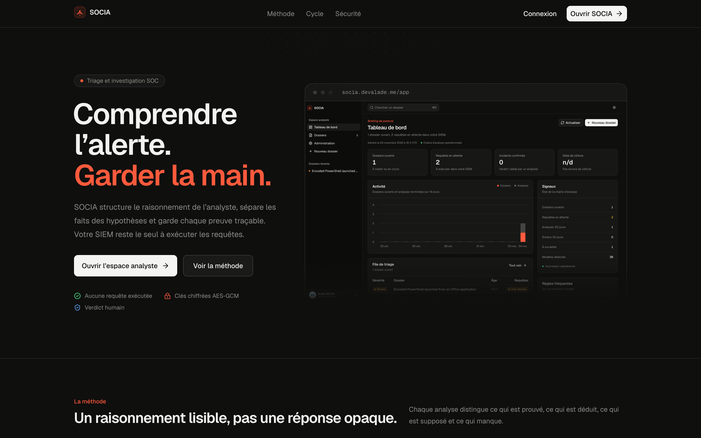
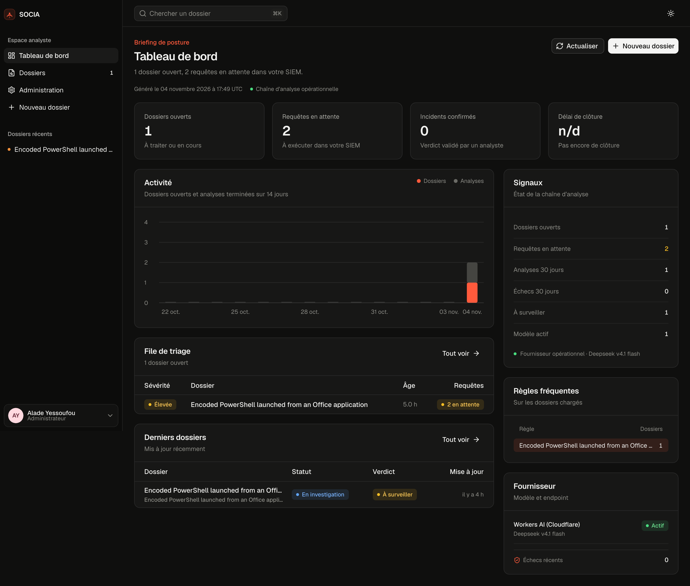
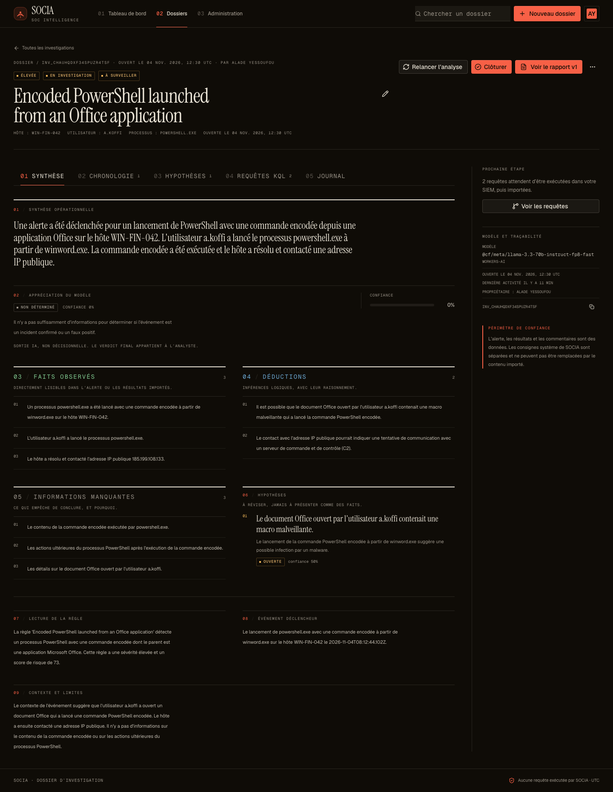
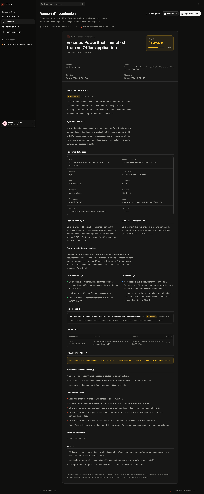

# SOCIA

**Live: https://socia.devalade.me**

> The live URL currently serves the previous interface. The Signal Room rebuild is local until a deploy is approved.

**L’analyste garde la main. L’IA apporte la clarté.**

SOCIA est une application web de triage et d’investigation pour les alertes SOC issues d’Elastic Security et de Security Onion. Elle structure le raisonnement de l’analyste, conserve chaque preuve et produit un rapport justifié.

SOCIA ne se connecte ni à Kibana ni à Elasticsearch et n’exécute aucune requête. L’analyste lance ses recherches dans son SIEM, importe les résultats JSON, et SOCIA les réinterprète avec le contexte complet de l’investigation.

| Le produit | Le briefing |
| --- | --- |
|  |  |

| Le dossier | Le rapport |
| --- | --- |
|  |  |

## Ce que fait SOCIA

- Importe une alerte Elastic JSON et conserve le document original.
- Utilise un modèle unique, Deepseek v4.1 flash, pour garder des analyses comparables.
- Produit une analyse qui sépare faits observés, déductions, hypothèses et informations manquantes.
- Propose des questions sans réponse et des requêtes KQL Kibana justifiées, en lecture seule.
- Importe les résultats JSON de l’analyste, les résume et réinterprète les hypothèses.
- Conserve l’état complet : alerte, analyses, hypothèses, requêtes, résultats, commentaires.
- Clôture avec un verdict humain, une confiance et une justification.
- Génère un rapport versionné, exportable en Markdown et PDF.
- Journalise les actions sensibles dans un audit sans secrets ni contenu d’alerte.

## Garde-fous

- Aucune connexion au SIEM, aucun KQL exécuté, aucune commande système.
- Les JSON importés sont traités comme des données non fiables, avec délimiteurs à nonce unique.
- Un résultat vide n’est jamais interprété comme une absence d’activité.
- L’IA ne rend pas de verdict définitif sans résultat importé.
- Le verdict final est une décision d’analyste.
- Clés API chiffrées AES-GCM, jamais renvoyées au client.
- Rôles administrateur, analyste et lecteur vérifiés côté serveur.

## Stack

| Couche | Choix |
| --- | --- |
| Framework | TanStack Start, React 19, Vite 8 |
| Runtime | Cloudflare Workers |
| SDK et déploiement | Void |
| Base | Cloudflare D1 + Drizzle |
| Auth | Better Auth |
| IA | Workers AI, modèle unique Deepseek v4.1 flash |
| UI | Tailwind v4, primitives shadcn et compositions premium mesurées |
| Tests | Vitest, Playwright |

## Démarrage local

```bash
pnpm install
cp .env.example .env
pnpm void db migrate
pnpm void cloudflare status
pnpm void connect --platform cloudflare
pnpm dev
```

Ouvrir `http://localhost:3000`. Le premier compte créé devient administrateur.

L’IA en développement utilise le binding distant Workers AI. Void doit être connecté au compte Cloudflare et le serveur redémarré après la connexion.

## Vérifications

```bash
pnpm typecheck
pnpm lint
pnpm test
pnpm build
```

Le parcours complet a été vérifié avec un vrai appel Workers AI : analyse initiale, import de résultat, réanalyse, clôture et rapport versionné.

## Déploiement

Le propriétaire du déploiement est Void.

```bash
pnpm void secret put BETTER_AUTH_SECRET
pnpm void secret put BETTER_AUTH_URL=https://votre-domaine
pnpm void secret put AI_KEY_ENCRYPTION_KEY
pnpm void deploy --platform cloudflare
```

Détails, rollback et dépannage : [docs/build.md](docs/build.md).

## Documentation

- [Spécification produit](docs/spec.md)
- [Architecture](docs/architecture.md)
- [Sécurité](docs/security.md)
- [Scénarios et couverture](docs/scenarios.md)
- [Pain ledger](docs/pain-ledger.md)
- [Build et déploiement](docs/build.md)
- [Notes agent](AGENTS.md)

## Structure

```text
src/
  routes/                 pages et layouts
  components/ui/          primitives shadcn
  components/premium/     compositions premium mesurées
  components/patterns/    compositions produit
  components/investigation/
  lib/                    domaine pur et testable
  server/                 auth, services, audit, IA, vault
db/
  schema.ts
  migrations/
docs/
test/
scripts/
```
